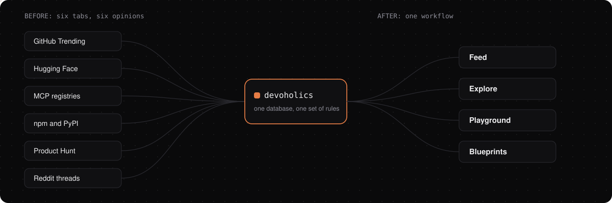
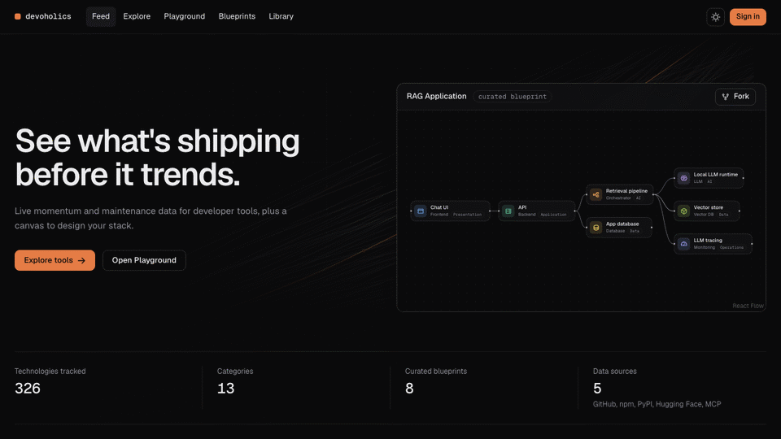
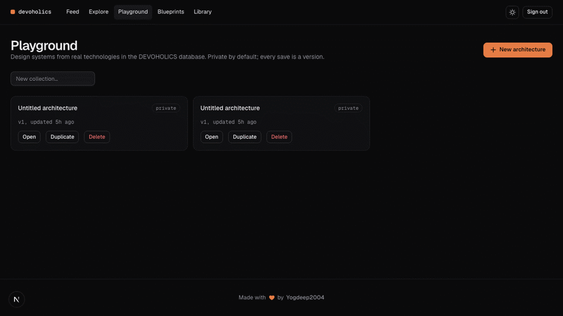
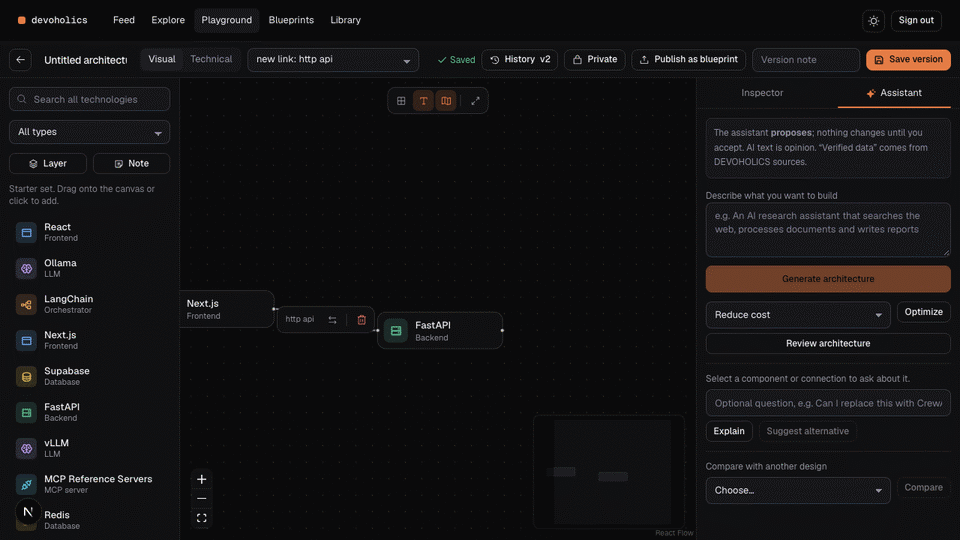
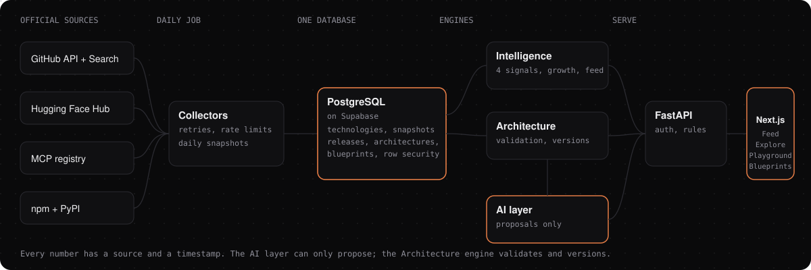

<div align="center">



<br>

**A developer intelligence and architecture workspace.** Find tools worth your time, judge them on evidence, and design your stack from real parts.

[](https://github.com/Yogdeep2004/Devoholics/actions/workflows/ci.yml)
[](https://devoholics-web.vercel.app)


[**Open the live app**](https://devoholics-web.vercel.app) · [API docs](https://devoholics-api.vercel.app/docs) · [Design system](docs/design/DESIGN.md) · [Deploy notes](docs/DEPLOY.md)

</div>

---

## The problem

Picking a stack in 2026 means opening six tabs and trusting none of them.



| What goes wrong today | Why it hurts |
|---|---|
| **Information is scattered.** GitHub Trending, Hugging Face, MCP registries, npm, Product Hunt, Reddit. | You re-assemble the same picture by hand for every project, and miss things. |
| **Stars measure attention, not health.** A repo can have 60k stars and no commits in six months. | You adopt something popular, then discover it is abandoned or inflated. |
| **Nobody can tell what is *new* and *real*.** Trending lists are dominated by tools that were already famous. | Genuinely new tools are invisible until they are everywhere. |
| **"Does X work with Y?" has no reliable answer.** Integration claims are scattered across READMEs. | You find out a connection is missing after you have built around it. |
| **AI advice cannot be audited.** A chatbot will confidently design your architecture and invent details. | You cannot tell fact from fluent guesswork, and it may rewrite your work. |
| **There is nowhere to *design* with real tools.** Diagram apps know boxes, not technologies. | The research and the design live in different places and drift apart. |

## What DEVOHOLICS does

It keeps discovery and design in **one workspace backed by one database**, so what you learn about a tool is the same data you use when you place it on a canvas.

<table>
<tr>
<td width="50%" valign="top">

### Discover
A feed of releases, **new tools** and maintenance warnings from GitHub, package registries and the MCP registry. Every card says *why you are seeing it*.

</td>
<td width="50%" valign="top">

### Judge
Each technology gets **four independent signals** (momentum, maintenance, ecosystem, readiness). There is deliberately **no single score**, and missing data is shown as missing.

</td>
</tr>
<tr>
<td valign="top">

### Design
A visual **Playground** where every component is a real technology from the database, with connection types, validation and version history.

</td>
<td valign="top">

### Decide
An **AI assistant that only proposes.** You preview every change on your canvas and accept or reject it. Your original design is never overwritten.

</td>
</tr>
</table>

## A quick tour

Public pages, recorded from the live site:



### Trending tools, with what you could use them for

The catalogue is mostly established tools, so "trending" on its own would never surface anything new. A daily job queries GitHub's official Search API for **recently created repositories that are gaining stars fast**, ranks them by average stars per day since launch, and adds an AI-written summary of **what you could use each one for**.

- The summary is written from the repository's own description and topics, is told not to invent features, and is **always labelled "AI summary"**.
- A repo with an unusually low fork-to-star ratio gets a neutral **"low fork ratio"** caution instead of the featured slot, because inflated stars are a known problem.
- The number is labelled for what it is: an average since launch, not a measure of quality.

### Design on a canvas that knows the tools

Recorded on a local copy of the catalogue (sign-in is needed for the Playground):



- Drag in components from a library that searches the whole technology database.
- Connections have **types** (HTTP API, retrieval, LLM inference, MCP, and more). A connection is marked **verified**, **compatible** (matches a common structural pattern) or **unverified**. "Compatible" is never presented as proof that two products integrate.
- Select a node for a floating bar: **duplicate, replace with an alternative, lock position, open its profile, delete**. Select a connection to **reverse** or **delete** it.
- Toggle **snap to grid, connection labels, the minimap** and fit-to-view. Every save is a version you can restore.
- Fork one of **8 curated blueprints** (RAG app, multi-agent research assistant, coding assistant, voice assistant, support agent, AI SaaS, document pipeline, computer vision) instead of starting blank, or publish your own to the community library (moderated).

### An AI assistant you can audit



The model never touches your design. Its output is structured JSON that the **backend validates** (unknown components, bad connections, duplicate ids and stale proposals are rejected with explicit errors). You see the result **as a preview on your canvas**, choose which operations to accept, and only then is a **new version** saved. The earlier versions stay restorable.



This recording uses the real model. It can generate an architecture, explain a component, suggest alternatives, optimize for an objective (cost, scale, complexity), review a design, and compare two designs. AI text is kept visibly separate from **verified data** (license, stars, last push, release) that comes from the database.

## Built to be trusted

| Principle | In practice |
|---|---|
| **No fabricated data** | Metrics come from official APIs with timestamps. Unknown stays `n/a`; it is never zero and never guessed. |
| **No hidden score** | Four dimensions are shown side by side. Popularity, maintenance and production adoption are different things. |
| **Rankings you can read** | Feed ranking is deterministic, and each card lists exactly which rules contributed (recency, followed, in your stack...). |
| **AI proposes, you decide** | Every change goes through validation, preview and explicit approval. Stale proposals are refused. |
| **Facts vs opinion** | Verified database facts and AI-written text are labelled and displayed separately. |
| **Private by default** | Designs are private until you publish. Ownership is enforced on the server; other people's private designs return 404. |
| **Community with guardrails** | Submitted blueprints are validated, link-spam checked, moderated, and can be reported. Rejections require a reason. |

## How it works



**The four signals** shown on every technology page:

| Signal | Looks at | Never claims |
|---|---|---|
| **Momentum** | Star growth, acceleration (needs snapshot history) | That growth means quality |
| **Maintenance** | Days since last push and release, open issues, contributors | That activity means production readiness |
| **Ecosystem** | Verified integrations and relationships | Integrations nobody has verified |
| **Readiness** | License, docs, published releases | A grade or ranking |

**Data sources:** the [GitHub REST and Search APIs](https://docs.github.com/en/rest), the [Hugging Face Hub](https://huggingface.co/docs/hub), the [official MCP registry](https://registry.modelcontextprotocol.io/), npm and PyPI. No unauthorized scraping. A scheduled GitHub Action refreshes everything daily, which is also what builds the history that growth numbers depend on.

## Tech stack

| Layer | Choices |
|---|---|
| **Frontend** | Next.js 16, React 19, TypeScript, Tailwind CSS v4, React Flow, Zustand, Recharts, Motion, Phosphor icons |
| **Backend** | FastAPI, Pydantic, SQLAlchemy 2, Alembic |
| **Data and auth** | PostgreSQL on Supabase, row-level security on every table, Supabase Auth (JWTs verified server-side) |
| **AI** | Any OpenAI-compatible API (default: Groq `openai/gpt-oss-120b`, free tier). Provider-agnostic, output validated with Pydantic with one repair retry |
| **Hosting** | Vercel (web and API), GitHub Actions (CI and the daily refresh) |
| **Design** | Dark-first, one accent, WCAG AA contrast in both themes. See [DESIGN.md](docs/design/DESIGN.md) |

## Run it locally

You need Node 22, Python 3.12+, a Supabase project (free), and a GitHub token. An LLM key is optional; everything except the AI assistant works without one.

```bash
git clone https://github.com/Yogdeep2004/Devoholics.git && cd Devoholics
cp .env.example .env            # fill in DATABASE_URL, GITHUB_TOKEN, SUPABASE_*, optional LLM_API_KEY

# backend
cd apps/api
python3 -m venv .venv && .venv/bin/pip install -e ".[dev]"
.venv/bin/alembic upgrade head
.venv/bin/python -m app.cli seed          # curated technologies
.venv/bin/python -m app.cli refresh       # collect data, discover new tools, write summaries
.venv/bin/python -m app.cli blueprints    # the 8 curated blueprints
.venv/bin/uvicorn app.main:app --port 8010 --reload

# frontend (second terminal)
cd apps/web
cp .env.example .env.local      # NEXT_PUBLIC_API_URL=http://localhost:8010
npm install && npm run dev
```

Open <http://localhost:3000>. Create an account to use the Playground. To moderate community blueprints, run `.venv/bin/python -m app.cli make-admin you@example.com` and open `/admin`.

**Tests:** `cd apps/api && .venv/bin/pytest` (66 tests: API, graph validation, AI proposal rules, ingestion, ownership) and `cd apps/web && npm test` (23 tests). Both run in CI together with a type check, lint and a production build. The browser flows (canvas editing, the AI approval flow, blueprints and moderation) were verified with Playwright scripts that are not part of CI yet.

## Project layout

```
apps/api/    FastAPI app: collectors, intelligence, architecture engine, AI layer, migrations, tests
apps/web/    Next.js app: pages, canvas editor, components, tests
docs/        design system, deployment notes, phase notes, README assets
.github/     CI and the daily data refresh
```

## Honest status

- **Growth numbers need time.** Momentum and the history charts fill in as daily snapshots accumulate. On day one they correctly say there is not enough history yet.
- **"Trending" is not "good".** It shows what is gaining stars fastest, with caution flags where a pattern looks off. It is a place to start looking, not a recommendation.
- **AI summaries and proposals can be wrong.** They are labelled, grounded in the repository text, validated before use, and never applied without your approval. Verify against each tool's documentation.
- **Not built yet:** advanced personalised ranking, a technology radar, an ecosystem relationship graph, cost estimation, custom alerts and team workspaces. These wait for real demand.

---

<div align="center">

Made with ❤️ by [Yogdeep2004](https://github.com/Yogdeep2004)

</div>
